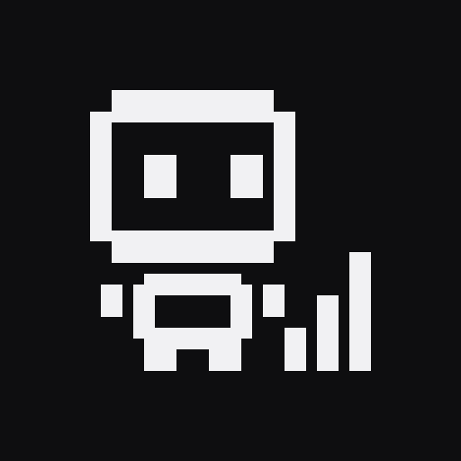
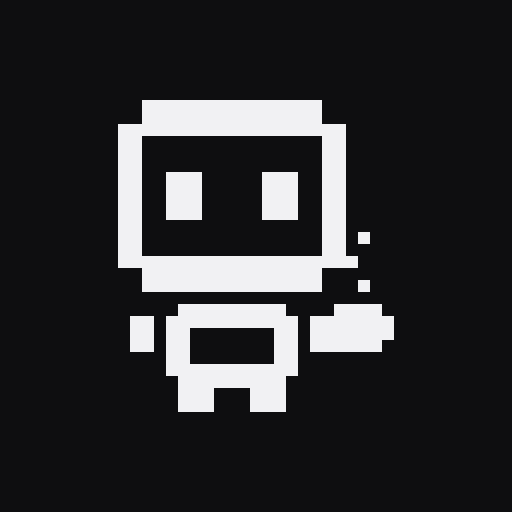
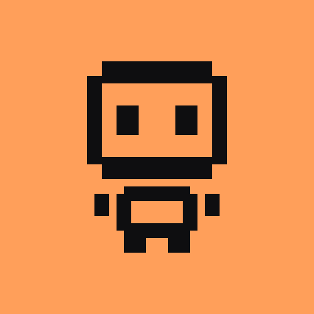
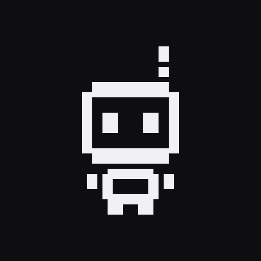
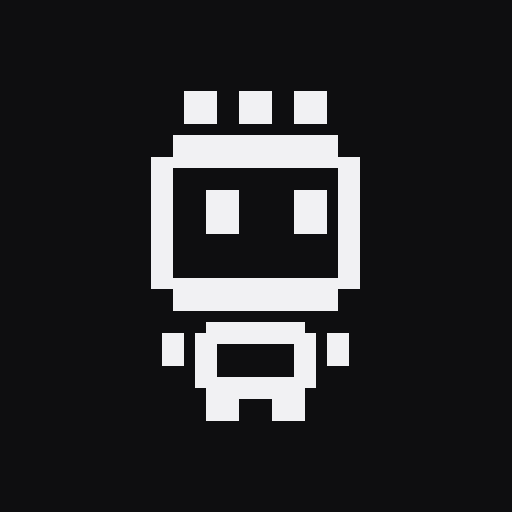
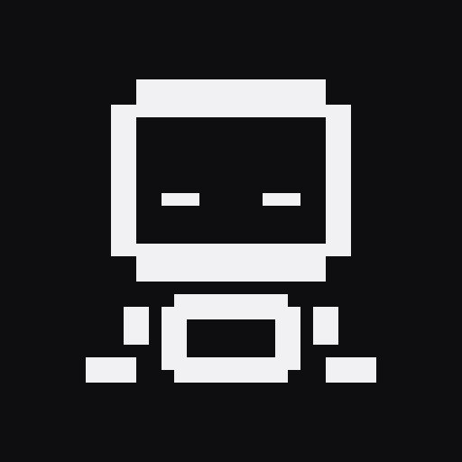

# Welcome to OPTBOT

Set up your GitHub account in five minutes. Every OPTBOT member's account looks the same, so the team reads as one company.

## 1. Username and name

- **Username:** `firstname-lastname-optbot` (Settings → Account → Change username). Example: `griffin-thompson-optbot`.
- **Name:** your real name. **Bio:** your role at OPTBOT. **Company:** `@OptBot-AI`.

## 2. Profile picture: pick one of the official OPTBOT robots

OPTBOT members use one of these as their GitHub (and Slack and Google) picture. Click one to open it, save it, then upload it at **Settings → Public profile → Profile picture → Upload a photo**.

<table>
<tr>
<td align="center"> <code>chart</code></td>
<td align="center"> <code>coffee</code></td>
<td align="center"> <code>ember-face</code></td>
<td align="center"> <code>ember-wave</code></td>
<td align="center"> <code>face-solid</code></td>
</tr>
<tr>
<td align="center"> <code>face</code></td>
<td align="center"> <code>hockey</code></td>
<td align="center"> <code>idea</code></td>
<td align="center"> <code>read</code></td>
<td align="center"> <code>solid</code></td>
</tr>
<tr>
<td align="center"> <code>think</code></td>
<td align="center"> <code>trophy</code></td>
<td align="center"> <code>typing</code></td>
<td align="center"> <code>wave</code></td>
<td align="center"> <code>zen</code></td>
</tr>
</table>

## 3. Security

- Turn on two-factor authentication with an authenticator app or a passkey, not SMS (Settings → Password and authentication). The organization requires it.
- Add and verify your @optbotai.com email and make it primary.

## 4. Reactions

We react with the OPTBOT robot instead of emoji. Save your favorites as saved replies (Settings → Saved replies), named after the reaction, so typing `ctrl + .` in any comment box inserts them. The full set is in [STANDARDS.md](STANDARDS.md#5-culture-optbot-reactions-not-emoji).

## 5. Claude

Install the `optbot-design` skill from the design-system repository, and in the superhead repository tell Claude "we're labeling new data to make a superhead". Every repository has a `CLAUDE.md`.

Read [STANDARDS.md](STANDARDS.md) next.
