# Welcome to OPTBOT

Ten minutes and you look, react and work like the rest of the team. **Fastest way:** open Claude and say **"onboard me to OPTBOT"** (or, for someone else, "onboard Jane Doe to OPTBOT"). The `optbot-onboarding` skill ([skills/optbot-onboarding](skills/optbot-onboarding/SKILL.md)) walks every step below and does the clicking for you.

## 1. Username and name

- **Username:** `firstname-lastname-optbot` (Settings → Account → Change username). Example: `griffin-thompson-optbot`.
- **Name:** your real name. **Bio:** your role at OPTBOT. **Company:** `@OptBot-AI`.

## 2. Profile picture: pick your OPTBOT

Every OPTBOT picture is the standard robot: white frame, black face, white eyes, no other colors. Pick one of the 50 below and use the same one on GitHub, Slack and Google.

1. **Click** the robot you want. It opens full size (512 × 512).
2. **Save** it (right-click → Save image, or long-press on a phone).
3. **Upload:** GitHub → [Settings → Profile](https://github.com/settings/profile) → Profile picture → Edit → Upload a photo. Slack → Profile → Edit → Upload image. Google → myaccount.google.com → Profile picture.

The CEO edition (shades and a tie) is reserved for the CEO.

#### Faces

<table>
<tr><td align="center"><a href="https://raw.githubusercontent.com/OptBot-AI/.github/main/assets/avatars/optbot-avatar-classic.png">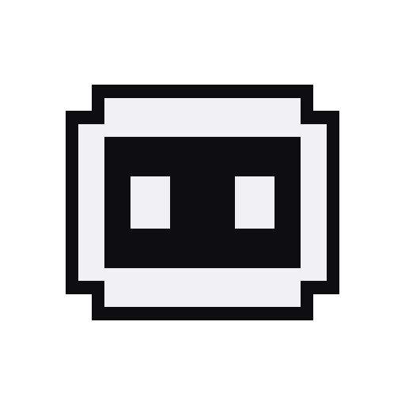</a> <code>classic</code></td><td align="center"><a href="https://raw.githubusercontent.com/OptBot-AI/.github/main/assets/avatars/optbot-avatar-blink.png">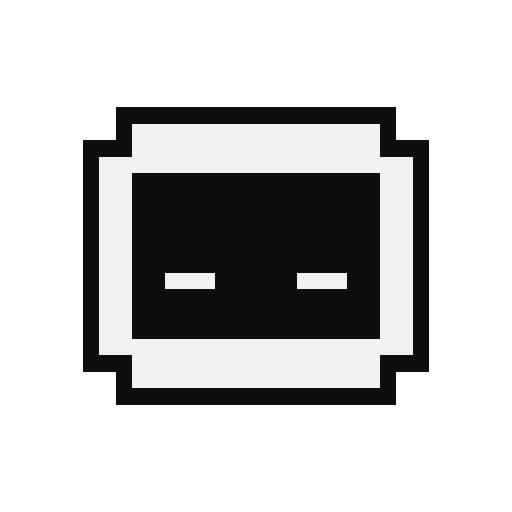</a> <code>blink</code></td><td align="center"><a href="https://raw.githubusercontent.com/OptBot-AI/.github/main/assets/avatars/optbot-avatar-wink.png">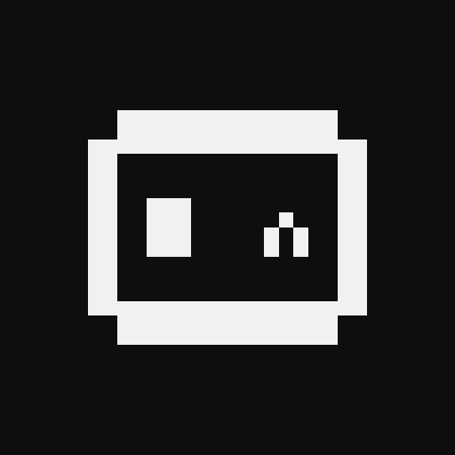</a> <code>wink</code></td><td align="center"> <code>happy</code></td><td align="center"><a href="https://raw.githubusercontent.com/OptBot-AI/.github/main/assets/avatars/optbot-avatar-side-eye.png">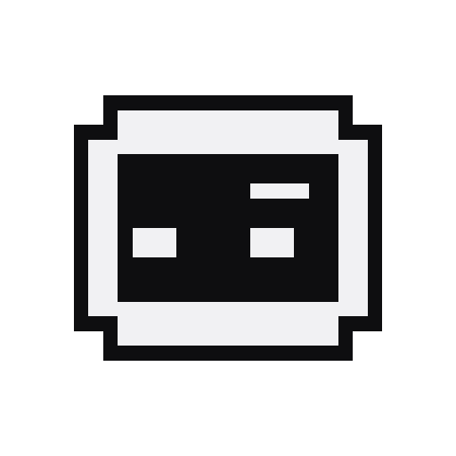</a> <code>side-eye</code></td></tr>
<tr><td align="center"><a href="https://raw.githubusercontent.com/OptBot-AI/.github/main/assets/avatars/optbot-avatar-focused.png">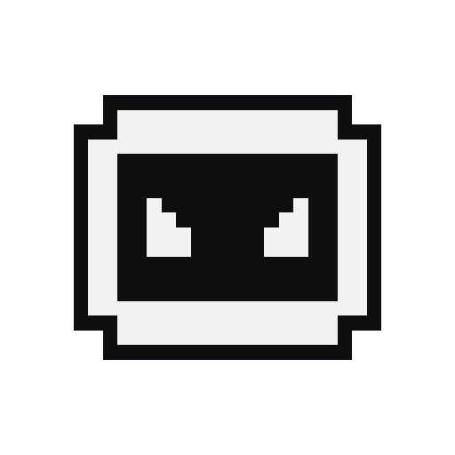</a> <code>focused</code></td><td align="center"><a href="https://raw.githubusercontent.com/OptBot-AI/.github/main/assets/avatars/optbot-avatar-shades.png">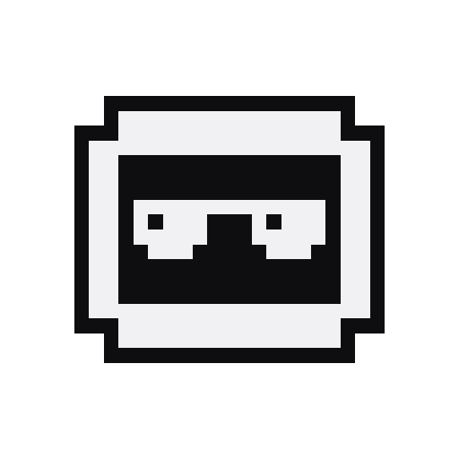</a> <code>shades</code></td><td align="center"><a href="https://raw.githubusercontent.com/OptBot-AI/.github/main/assets/avatars/optbot-avatar-heart-eyes.png">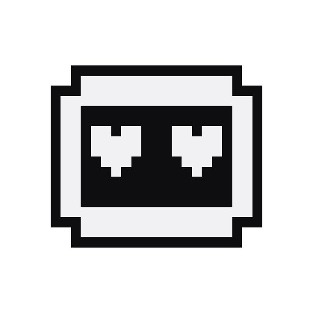</a> <code>heart-eyes</code></td><td align="center"><a href="https://raw.githubusercontent.com/OptBot-AI/.github/main/assets/avatars/optbot-avatar-star-eyes.png">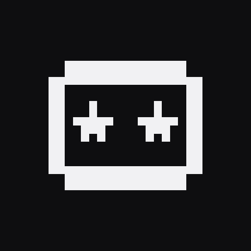</a> <code>star-eyes</code></td><td align="center"><a href="https://raw.githubusercontent.com/OptBot-AI/.github/main/assets/avatars/optbot-avatar-dizzy.png">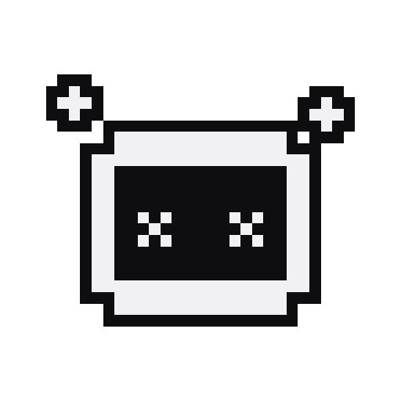</a> <code>dizzy</code></td></tr>
<tr><td align="center"><a href="https://raw.githubusercontent.com/OptBot-AI/.github/main/assets/avatars/optbot-avatar-sleepy.png">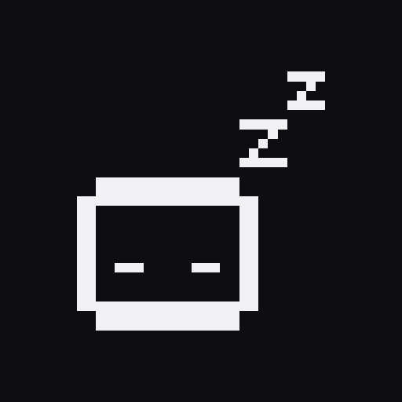</a> <code>sleepy</code></td></tr>
</table>

#### Headwear

<table>
<tr><td align="center"> <code>cap</code></td><td align="center"> <code>beanie</code></td><td align="center"><a href="https://raw.githubusercontent.com/OptBot-AI/.github/main/assets/avatars/optbot-avatar-crown.png">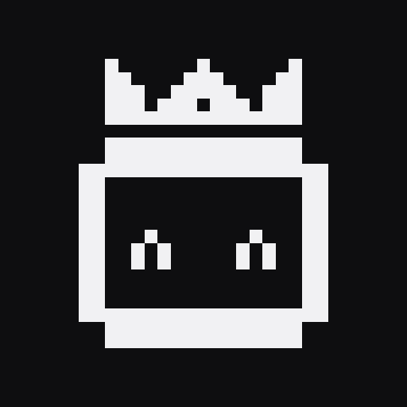</a> <code>crown</code></td><td align="center"><a href="https://raw.githubusercontent.com/OptBot-AI/.github/main/assets/avatars/optbot-avatar-top-hat.png">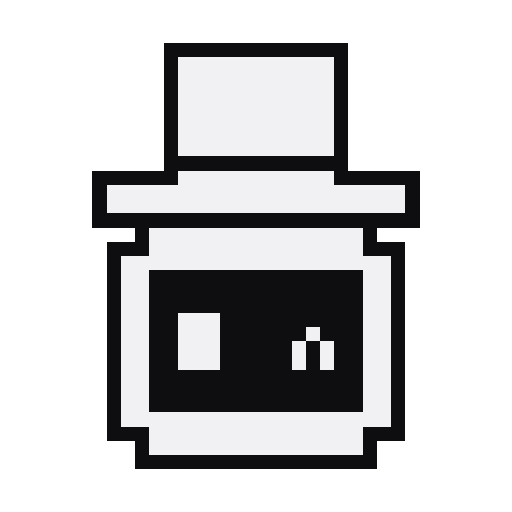</a> <code>top-hat</code></td><td align="center"><a href="https://raw.githubusercontent.com/OptBot-AI/.github/main/assets/avatars/optbot-avatar-headphones.png">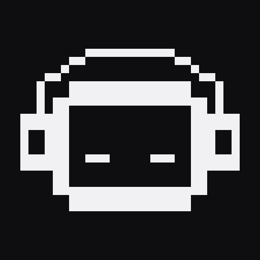</a> <code>headphones</code></td></tr>
<tr><td align="center"><a href="https://raw.githubusercontent.com/OptBot-AI/.github/main/assets/avatars/optbot-avatar-chef.png">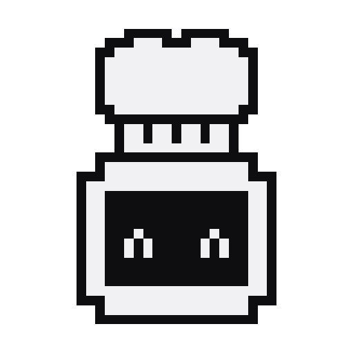</a> <code>chef</code></td><td align="center"><a href="https://raw.githubusercontent.com/OptBot-AI/.github/main/assets/avatars/optbot-avatar-party-hat.png">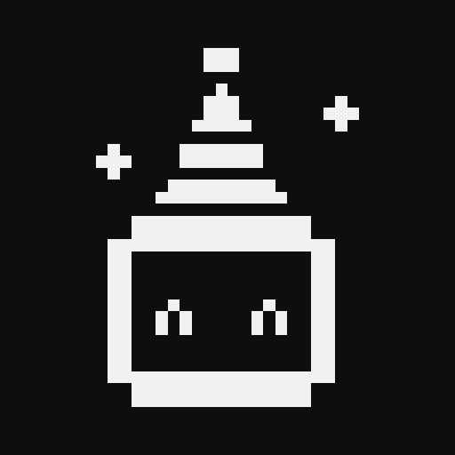</a> <code>party-hat</code></td><td align="center"><a href="https://raw.githubusercontent.com/OptBot-AI/.github/main/assets/avatars/optbot-avatar-wizard.png">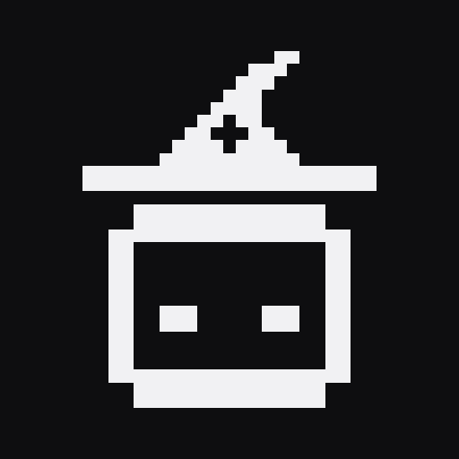</a> <code>wizard</code></td><td align="center"><a href="https://raw.githubusercontent.com/OptBot-AI/.github/main/assets/avatars/optbot-avatar-grad.png">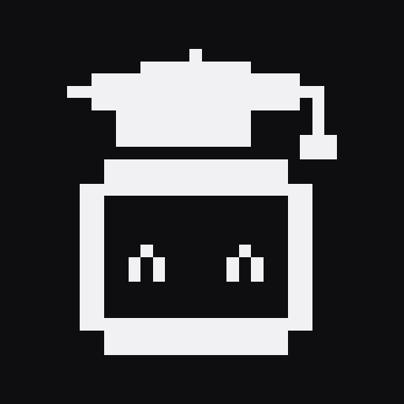</a> <code>grad</code></td><td align="center"><a href="https://raw.githubusercontent.com/OptBot-AI/.github/main/assets/avatars/optbot-avatar-halo.png">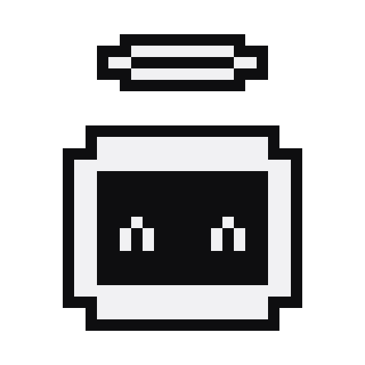</a> <code>halo</code></td></tr>
<tr><td align="center"><a href="https://raw.githubusercontent.com/OptBot-AI/.github/main/assets/avatars/optbot-avatar-antenna.png">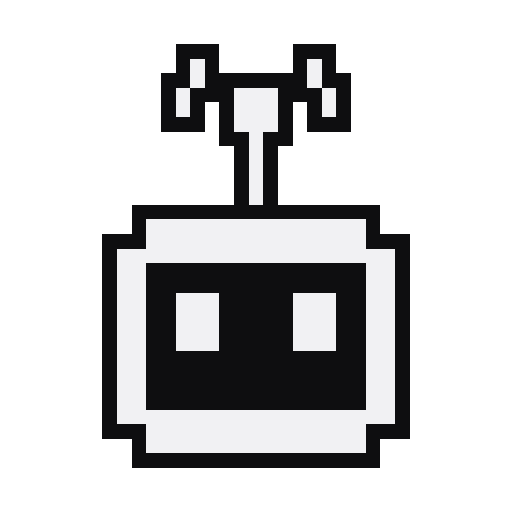</a> <code>antenna</code></td><td align="center"><a href="https://raw.githubusercontent.com/OptBot-AI/.github/main/assets/avatars/optbot-avatar-cowboy.png">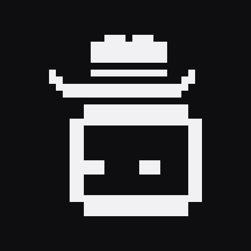</a> <code>cowboy</code></td></tr>
</table>

#### Sports

<table>
<tr><td align="center"><a href="https://raw.githubusercontent.com/OptBot-AI/.github/main/assets/avatars/optbot-avatar-hockey.png">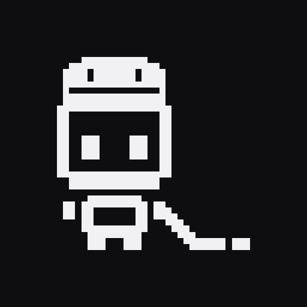</a> <code>hockey</code></td><td align="center"><a href="https://raw.githubusercontent.com/OptBot-AI/.github/main/assets/avatars/optbot-avatar-hockey-celly.png">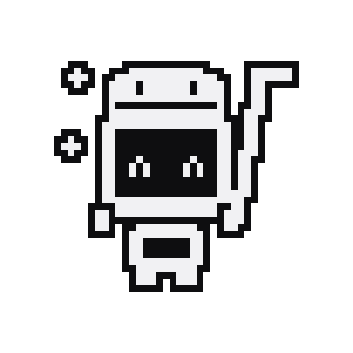</a> <code>hockey-celly</code></td><td align="center"><a href="https://raw.githubusercontent.com/OptBot-AI/.github/main/assets/avatars/optbot-avatar-golf-swing.png">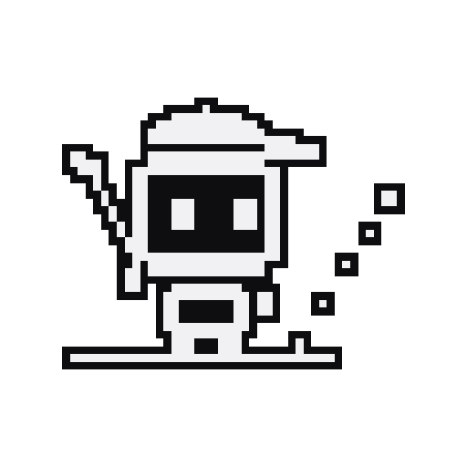</a> <code>golf-swing</code></td><td align="center"><a href="https://raw.githubusercontent.com/OptBot-AI/.github/main/assets/avatars/optbot-avatar-golf-putt.png">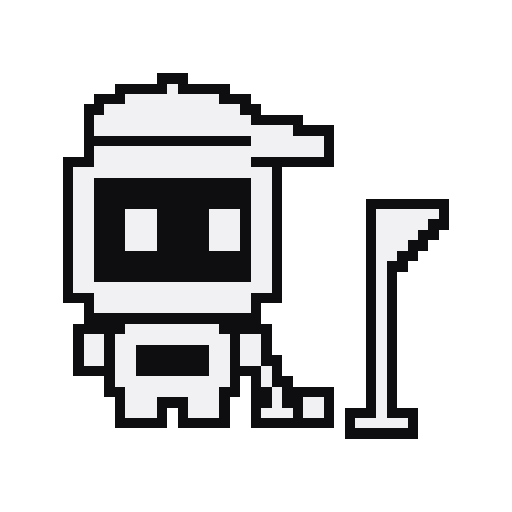</a> <code>golf-putt</code></td><td align="center"><a href="https://raw.githubusercontent.com/OptBot-AI/.github/main/assets/avatars/optbot-avatar-basketball.png">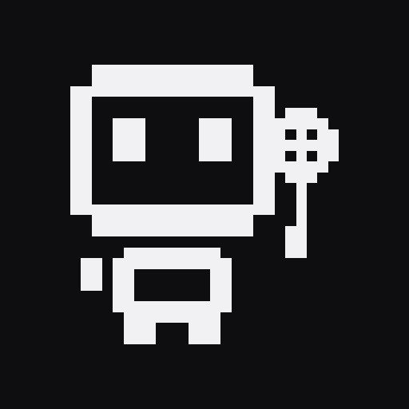</a> <code>basketball</code></td></tr>
<tr><td align="center"><a href="https://raw.githubusercontent.com/OptBot-AI/.github/main/assets/avatars/optbot-avatar-soccer.png">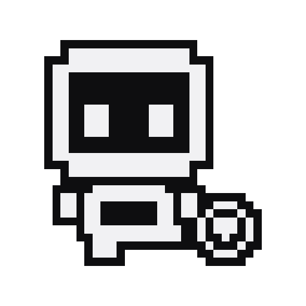</a> <code>soccer</code></td><td align="center"><a href="https://raw.githubusercontent.com/OptBot-AI/.github/main/assets/avatars/optbot-avatar-tennis.png">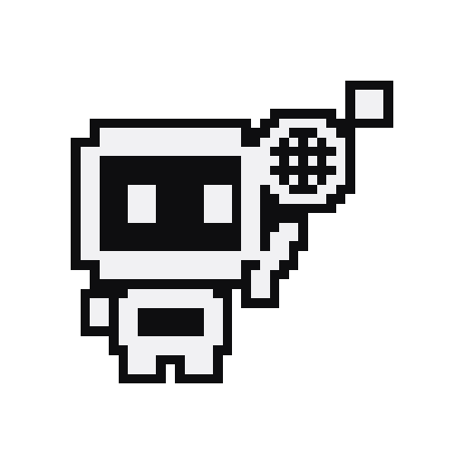</a> <code>tennis</code></td><td align="center"><a href="https://raw.githubusercontent.com/OptBot-AI/.github/main/assets/avatars/optbot-avatar-gym.png">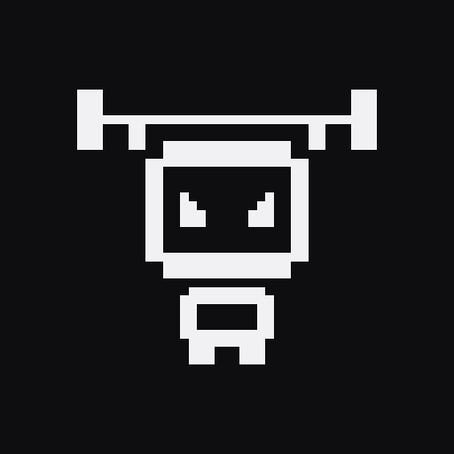</a> <code>gym</code></td><td align="center"><a href="https://raw.githubusercontent.com/OptBot-AI/.github/main/assets/avatars/optbot-avatar-skate.png">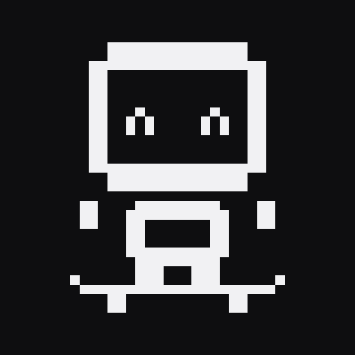</a> <code>skate</code></td><td align="center"><a href="https://raw.githubusercontent.com/OptBot-AI/.github/main/assets/avatars/optbot-avatar-trophy.png">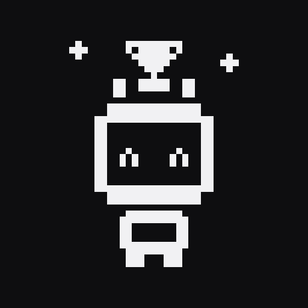</a> <code>trophy</code></td></tr>
</table>

#### Work

<table>
<tr><td align="center"><a href="https://raw.githubusercontent.com/OptBot-AI/.github/main/assets/avatars/optbot-avatar-laptop.png">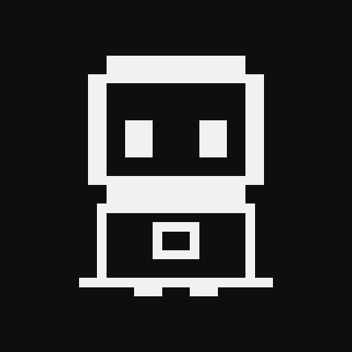</a> <code>laptop</code></td><td align="center"> <code>coffee</code></td><td align="center"> <code>chart</code></td><td align="center"><a href="https://raw.githubusercontent.com/OptBot-AI/.github/main/assets/avatars/optbot-avatar-detective.png">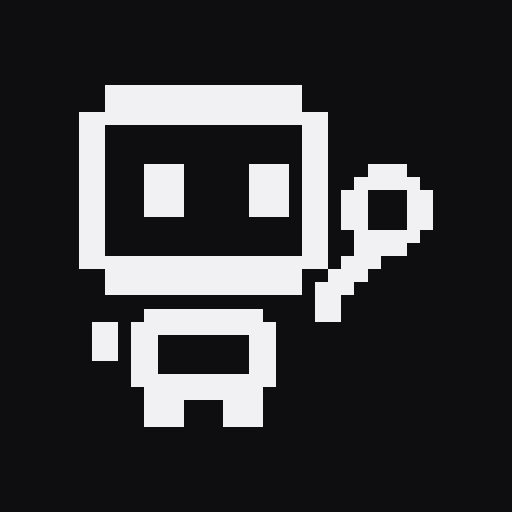</a> <code>detective</code></td><td align="center"> <code>idea</code></td></tr>
<tr><td align="center"><a href="https://raw.githubusercontent.com/OptBot-AI/.github/main/assets/avatars/optbot-avatar-launch.png">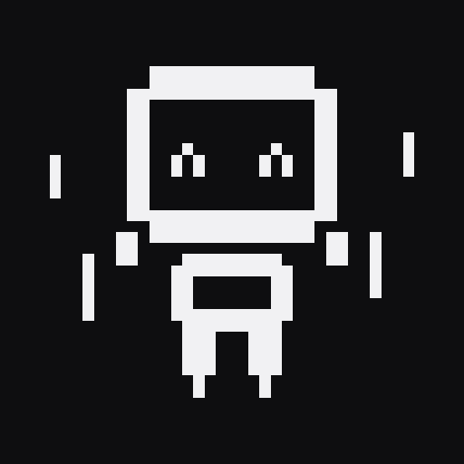</a> <code>launch</code></td><td align="center"><a href="https://raw.githubusercontent.com/OptBot-AI/.github/main/assets/avatars/optbot-avatar-support.png">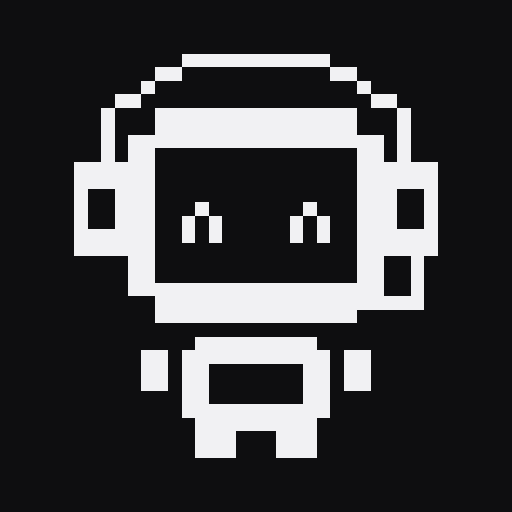</a> <code>support</code></td><td align="center"><a href="https://raw.githubusercontent.com/OptBot-AI/.github/main/assets/avatars/optbot-avatar-clipboard.png">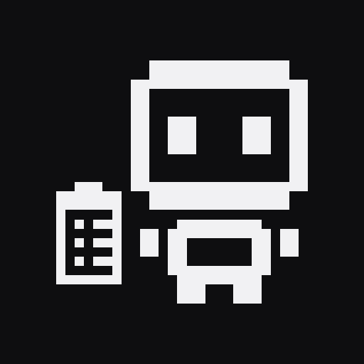</a> <code>clipboard</code></td><td align="center"><a href="https://raw.githubusercontent.com/OptBot-AI/.github/main/assets/avatars/optbot-avatar-briefcase.png">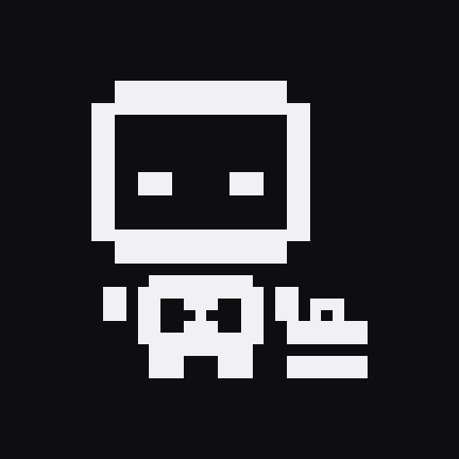</a> <code>briefcase</code></td></tr>
</table>

#### Fun

<table>
<tr><td align="center"><a href="https://raw.githubusercontent.com/OptBot-AI/.github/main/assets/avatars/optbot-avatar-wave.png">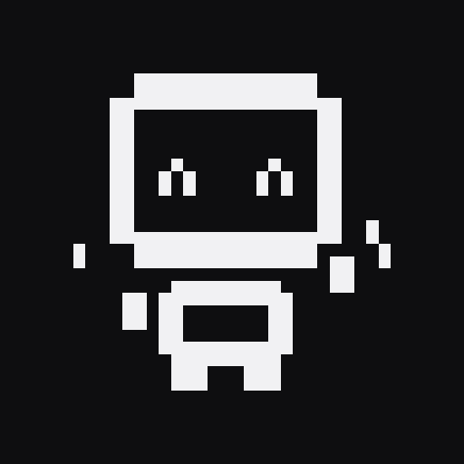</a> <code>wave</code></td><td align="center"><a href="https://raw.githubusercontent.com/OptBot-AI/.github/main/assets/avatars/optbot-avatar-thumbs-up.png">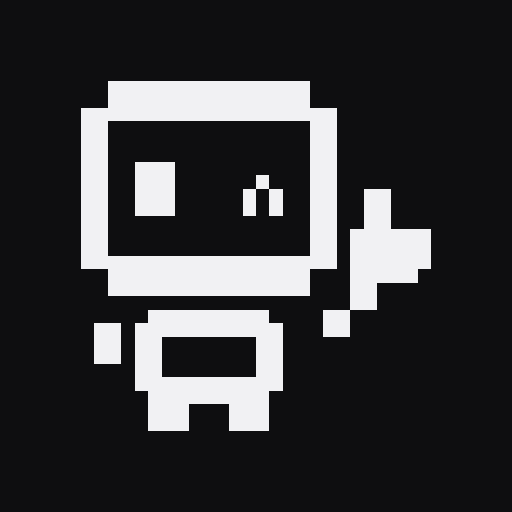</a> <code>thumbs-up</code></td><td align="center"><a href="https://raw.githubusercontent.com/OptBot-AI/.github/main/assets/avatars/optbot-avatar-guitar.png">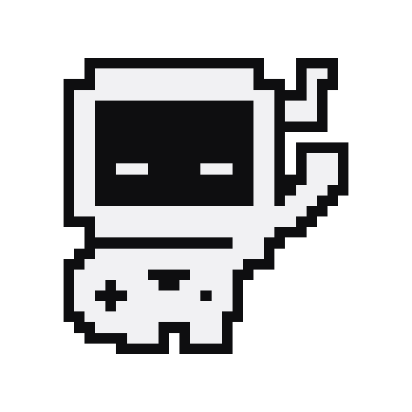</a> <code>guitar</code></td><td align="center"><a href="https://raw.githubusercontent.com/OptBot-AI/.github/main/assets/avatars/optbot-avatar-gamer.png">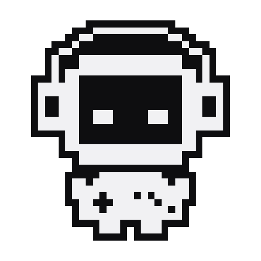</a> <code>gamer</code></td><td align="center"> <code>zen</code></td></tr>
<tr><td align="center"><a href="https://raw.githubusercontent.com/OptBot-AI/.github/main/assets/avatars/optbot-avatar-balloon.png">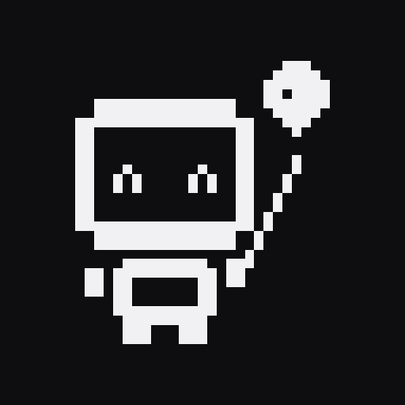</a> <code>balloon</code></td><td align="center"><a href="https://raw.githubusercontent.com/OptBot-AI/.github/main/assets/avatars/optbot-avatar-love.png">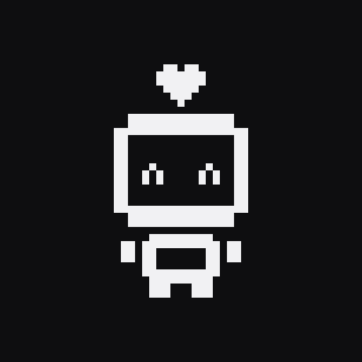</a> <code>love</code></td><td align="center"><a href="https://raw.githubusercontent.com/OptBot-AI/.github/main/assets/avatars/optbot-avatar-music.png">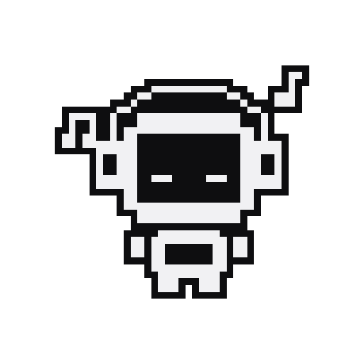</a> <code>music</code></td></tr>
</table>

## 3. Security

- Two-factor authentication with an authenticator app or a passkey, not SMS (Settings → Password and authentication). The organization requires it.
- Add and verify your @optbotai.com email and make it primary.

## 4. React like OPTBOT

We never use stock emoji when an OPTBOT robot fits.

- **Slack:** every robot is a workspace emoji named `:optbot-<name>:` and works as a reaction. Type `:optbot` in the reaction picker to see them all; your favorites float to the top.
- **GitHub saved replies:** add the reactions as saved replies (Claude adds all 66 for you during onboarding), titled `optbot <name>`. In any comment box press **Ctrl + .** (Cmd + . on Mac), type the name, Enter.
- **GitHub bot:** comment `/optbot <name>`, `/optbot random` or `/optbot list` on any issue or PR in an OPTBOT repository and the robot replies. It also reacts on its own to new issues, pull requests, reviews, merges and commits to `main`. Add `[skip optbot]` to keep it quiet.

The full list is in [STANDARDS.md](STANDARDS.md#5-culture-optbot-reactions-not-emoji).

## 5. Slack status

Use an OPTBOT status so everyone reads the same signals:

These are also the workspace's suggested statuses in Slack, so they show up when you click your status.

| Status | Emoji |
|---|---|
| Heads down | `:optbot-on-it:` 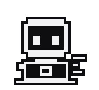 |
| In a meeting | `:optbot-meeting:` 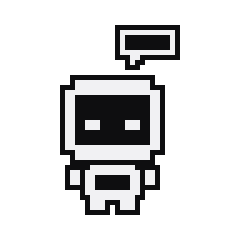 |
| On a call | `:optbot-support:` 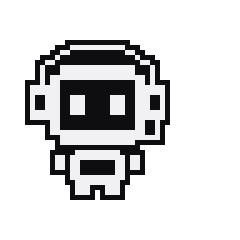 |
| On a break | `:optbot-coffee:` 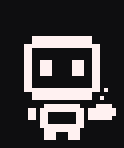 |
| Lunch | `:optbot-chef:` 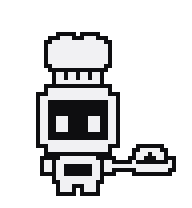 |
| Focus time | `:optbot-zen:` 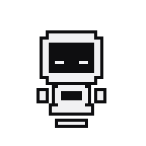 |
| Working remotely | `:optbot-remote:` 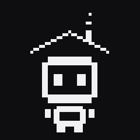 |
| Commuting | `:optbot-walk:`  |
| Out sick | `:optbot-sick:`  |
| Vacation | `:optbot-vacation:`  |
| Out of office | `:optbot-golf:`  |
| Recharging | `:optbot-recharge:`  |
| Offline | `:optbot-sleep:`  |

## 6. Claude

Install the `optbot-design` skill from the design-system repository and the `optbot-onboarding` skill from this repository. In the superhead repository tell Claude "we're labeling new data to make a superhead". Every repository has a `CLAUDE.md`.

Read [STANDARDS.md](STANDARDS.md) next.
