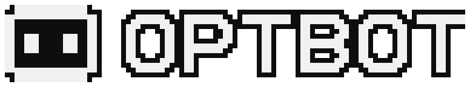
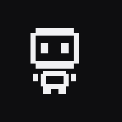

<!-- optbot:header -->

<h1 align="center">OptBot-AI/.github</h1>

<b>Organization-wide defaults for every OPTBOT repository.</b>

<!-- /optbot:header -->

| File | Does |
|---|---|
| `profile/README.md` | The organization's public profile page |
| `ONBOARDING.md` | New-member setup: username, official profile pictures, 2FA, reactions |
| `STANDARDS.md` | Engineering standards: names, workflow, security, culture |
| `PULL_REQUEST_TEMPLATE.md`, `ISSUE_TEMPLATE/` | Default templates for repositories without their own |
| `CONTRIBUTING.md`, `SECURITY.md` | Default contributing and security policies |
| `.github/workflows/optbot-reactions.yml` | **The OPTBOT bot**, shared by every repository: GIF reactions to issues, PRs, reviews, merges, commits on `main`, and `/optbot <name>` commands |
| `workflow-templates/optbot-reactions.yml` | The three-line caller every repository uses to switch the bot on |
| `.github/workflows/optbot-gifs-of-the-day.yml` | Rotates the GIF row on the organization profile every morning |
| `skills/optbot-onboarding/` | Claude skill: "onboard me to OPTBOT" or "onboard <name>" |
| `assets/avatars/`, `assets/reactions/`, `assets/gifs/`, `assets/slack-emoji/` | The approved profile pictures (50), reactions (24) and GIF library (87), Slack emoji (98). Generated in the design-system repository |
| `assets/` | Public brand images used in profiles and comments (reactions, avatars, banner, robot) |

This repository is public so GitHub can show the profile and serve the images. Nothing confidential goes here.

<!-- optbot:footer -->
 

 <b>OPTBOT</b> · <a href="https://www.optbotai.com">optbotai.com</a> · Proprietary and confidential

