# OPTBOT engineering standards

How every OPTBOT repository, account and contribution looks. Short on purpose; follow it exactly. New members start with [ONBOARDING.md](ONBOARDING.md).

## 1. Names

| Thing | Format | Example |
|---|---|---|
| GitHub username | `firstname-lastname-optbot` | `griffin-thompson-optbot` |
| Display name | Real name | Griffin Thompson |
| Profile picture | One of the official OPTBOT robots ([ONBOARDING.md](ONBOARDING.md#2-profile-picture-pick-one-of-the-official-optbot-robots)) | `optbot-avatar-wave` |
| Commit email | Your @optbotai.com address, verified | griffin@optbotai.com |
| Repository | lowercase, hyphens, a noun | `design-system`, `superhead` |
| Branch | `<type>/<short-topic>` with type `feat`, `fix`, `docs`, `chore`, `research` | `feat/kitchen-supply-pack` |
| Commit message | Conventional Commits: `<type>(<scope>): <what changed>` | `fix(loop): keep the holdout out of tuning` |
| Release tag | `vMAJOR.MINOR.PATCH` | `v1.1.0` |
| Files and folders | lowercase, hyphens; Python modules use underscores | `brand-guidelines.md`, `quote_heads.py` |
| Issue and PR titles | Sentence case, no trailing period | Add kitchen-supply starter pack |

The company name is always **OPTBOT**, in capitals. The product is **OPTBOT Core**.

## 2. Every repository has

`README.md` (what it is, how to run it, layout), `LICENSE` (proprietary), `CLAUDE.md` (how Claude should work in it), `CONTRIBUTING.md`, `.github/CODEOWNERS`, a CI workflow, and the PR and issue templates. A topic list on GitHub that includes `optbot`.

## 3. How work flows

1. One issue per piece of work. Branch from `main` (or `develop` where it exists).
2. Small pull requests, one change each. Fill in the template.
3. CI green and one code-owner approval before merge. **Squash-merge**, then delete the branch.
4. `main` is always releasable. Nobody pushes to it directly.

## 4. Security

- 2FA required for every member, with an authenticator app or passkey (not SMS).
- No secrets, tokens, customer data or other companies' code in any repository. Data lives outside the repo; configs point at it.
- Outside collaborators get access to only the repositories they work on.

## 5. Culture: OPTBOT reactions, not emoji

We react with our own robot, everywhere. Every robot is the white frame and black face on a transparent background: no black squares, no other colors.

**Where they live**

| Place | How |
|---|---|
| Slack | Workspace emoji `:optbot-<name>:`, usable as reactions and statuses. Search `:optbot` in the picker. |
| GitHub comments | Saved replies titled `optbot <name>` (**Ctrl + .** in any comment box), or paste the markdown below. |
| GitHub bot | `/optbot <name>`, `/optbot random`, `/optbot list` in any issue or PR comment. The bot also reacts to new issues, PRs, approvals, merges and commits on `main` (`[skip optbot]` to silence). One shared workflow: `.github/workflows/optbot-reactions.yml` in this repository. |
| Docs, decks, READMEs | The files in `assets/` here, or `exports/` in the design-system repository. |

**Reactions** (the 24 with a meaning; use these in reviews and threads)

| | Name | Means | Slack | GitHub markdown |
|---|---|---|---|---|
| 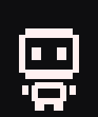 | `thumbs-up` | Approve, looks good | `:optbot-thumbs-up:` | `` |
|  | `ship-it` | Done, merged, shipped | `:optbot-ship-it:` | `` |
| 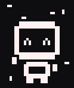 | `party` | Celebrate a win | `:optbot-party:` | `` |
|  | `trophy` | A result, a milestone | `:optbot-trophy:` | `` |
| 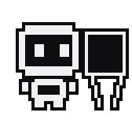 | `chart` | The numbers are up | `:optbot-chart:` | `` |
|  | `love` | Love it | `:optbot-love:` | `` |
| 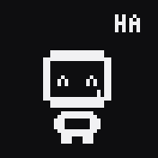 | `laugh` | That's funny | `:optbot-laugh:` | `` |
| 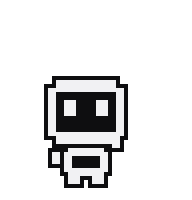 | `thinking` | Thinking about it | `:optbot-thinking:` | `` |
|  | `idea` | Good idea | `:optbot-idea:` | `` |
|  | `shrug` | Not sure, need data | `:optbot-shrug:` | `` |
|  | `facepalm` | Oops | `:optbot-facepalm:` | `` |
|  | `eyes` | Looking into it | `:optbot-eyes:` | `` |
| 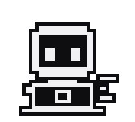 | `on-it` | Working on it | `:optbot-on-it:` | `` |
|  | `bug` | Something broke | `:optbot-bug:` | `` |
| 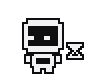 | `waiting` | Blocked, waiting | `:optbot-waiting:` | `` |
| 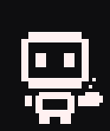 | `coffee` | Break | `:optbot-coffee:` | `` |
|  | `wave` | Hello | `:optbot-wave:` | `` |
| 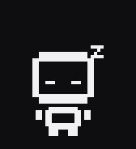 | `sleep` | Away, offline, brb | `:optbot-sleep:` | `` |
| 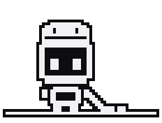 | `hockey` | CIN, hockey | `:optbot-hockey:` | `` |
| 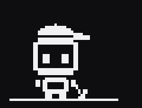 | `golf` | Nice shot, great work | `:optbot-golf:` | `` |
| 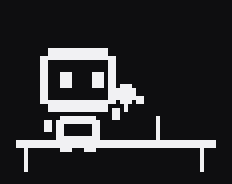 | `ping-pong` | Back and forth, your turn | `:optbot-ping-pong:` | `` |
| 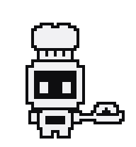 | `chef` | Cooking something up | `:optbot-chef:` | `` |
| 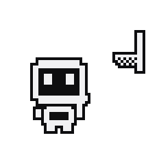 | `basketball` | Nailed it | `:optbot-basketball:` | `` |
| 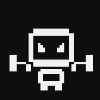 | `gym` | Putting in the work | `:optbot-gym:` | `` |

**The GIF library** (one per profile picture, status robots for Slack, and Max's classics: 87 in all). In Slack: `:optbot-<name>:` (two renamed to avoid clashes: `:optbot-chef-hat:`, `:optbot-ball-spin:`). In markdown: ``.

**Faces**

<table>
<tr><td align="center">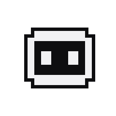 <code>classic</code></td><td align="center">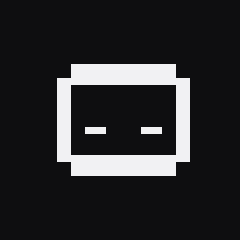 <code>blink</code></td><td align="center"> <code>wink</code></td><td align="center">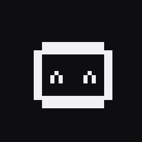 <code>happy</code></td><td align="center">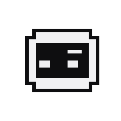 <code>side-eye</code></td><td align="center">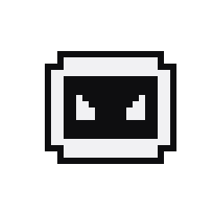 <code>focused</code></td><td align="center">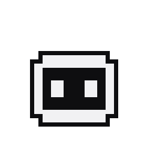 <code>shades</code></td><td align="center">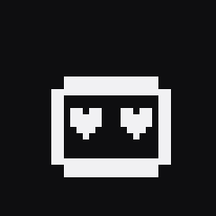 <code>heart-eyes</code></td></tr>
<tr><td align="center">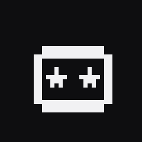 <code>star-eyes</code></td><td align="center">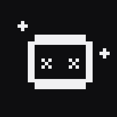 <code>dizzy</code></td><td align="center">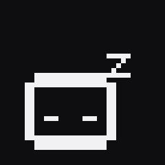 <code>sleepy</code></td></tr>
</table>

**Headwear**

<table>
<tr><td align="center">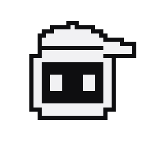 <code>cap</code></td><td align="center">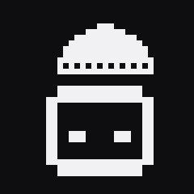 <code>beanie</code></td><td align="center">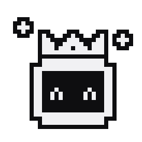 <code>crown</code></td><td align="center">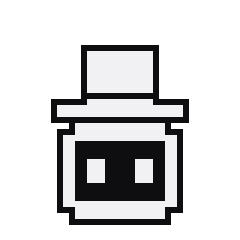 <code>top-hat</code></td><td align="center">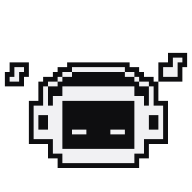 <code>headphones</code></td><td align="center">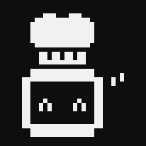 <code>chef</code></td><td align="center">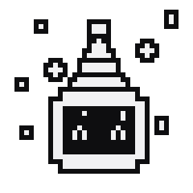 <code>party-hat</code></td><td align="center">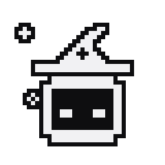 <code>wizard</code></td></tr>
<tr><td align="center">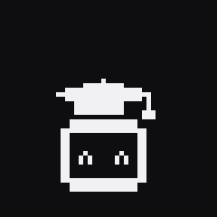 <code>grad</code></td><td align="center">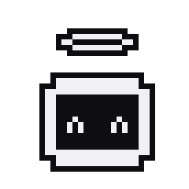 <code>halo</code></td><td align="center">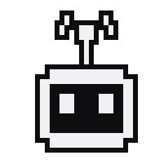 <code>antenna</code></td><td align="center">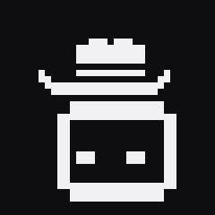 <code>cowboy</code></td></tr>
</table>

**Sports**

<table>
<tr><td align="center">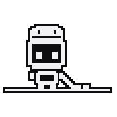 <code>hockey</code></td><td align="center">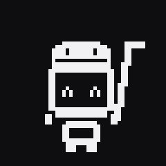 <code>hockey-celly</code></td><td align="center">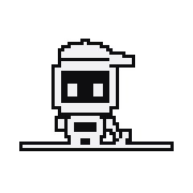 <code>golf-swing</code></td><td align="center">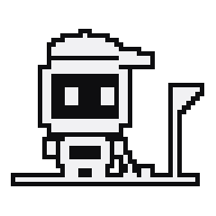 <code>golf-putt</code></td><td align="center">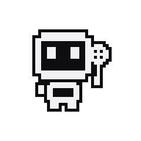 <code>basketball</code></td><td align="center">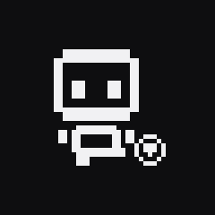 <code>soccer</code></td><td align="center">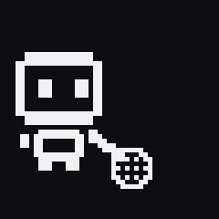 <code>tennis</code></td><td align="center">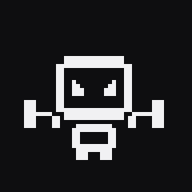 <code>gym</code></td></tr>
<tr><td align="center">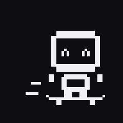 <code>skate</code></td><td align="center">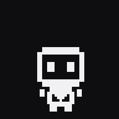 <code>trophy</code></td></tr>
</table>

**Work**

<table>
<tr><td align="center">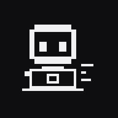 <code>laptop</code></td><td align="center">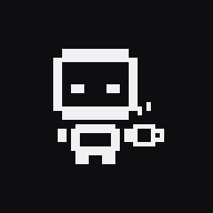 <code>coffee</code></td><td align="center">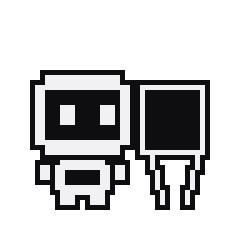 <code>chart</code></td><td align="center"> <code>detective</code></td><td align="center"> <code>idea</code></td><td align="center"> <code>launch</code></td><td align="center"> <code>support</code></td><td align="center"> <code>clipboard</code></td></tr>
<tr><td align="center"> <code>briefcase</code></td></tr>
</table>

**Fun**

<table>
<tr><td align="center"> <code>wave</code></td><td align="center"> <code>thumbs-up</code></td><td align="center"> <code>guitar</code></td><td align="center"> <code>gamer</code></td><td align="center"> <code>zen</code></td><td align="center"> <code>balloon</code></td><td align="center"> <code>love</code></td><td align="center"> <code>music</code></td></tr>
</table>

**Status**

<table>
<tr><td align="center"> <code>meeting</code></td><td align="center"> <code>recharge</code></td><td align="center"> <code>remote</code></td><td align="center"> <code>sick</code></td><td align="center"> <code>vacation</code></td></tr>
</table>

**Classics**

<table>
<tr><td align="center"> <code>look</code></td><td align="center"> <code>cursor</code></td><td align="center"> <code>no</code></td><td align="center"> <code>yes</code></td><td align="center"> <code>boot</code></td><td align="center"> <code>scan</code></td><td align="center"> <code>glitch</code></td><td align="center"> <code>sad</code></td></tr>
<tr><td align="center"> <code>angry</code></td><td align="center"> <code>excited</code></td><td align="center"> <code>loading</code></td><td align="center"> <code>walk</code></td><td align="center"> <code>sit</code></td><td align="center"> <code>sit-down</code></td><td align="center"> <code>hop</code></td><td align="center"> <code>jump</code></td></tr>
<tr><td align="center"> <code>dance</code></td><td align="center"> <code>forecast</code></td><td align="center"> <code>point</code></td><td align="center"> <code>peek</code></td><td align="center"> <code>turn</code></td><td align="center"> <code>look-back</code></td><td align="center"> <code>chase</code></td><td align="center"> <code>throw</code></td></tr>
<tr><td align="center"> <code>flip</code></td><td align="center"> <code>shoot</code></td><td align="center"> <code>trip</code></td><td align="center"> <code>cry</code></td><td align="center"> <code>surprised</code></td><td align="center"> <code>success</code></td><td align="center"> <code>read</code></td><td align="center"> <code>sort</code></td></tr>
</table>

**Slack statuses:** see [ONBOARDING.md](ONBOARDING.md#5-slack-status).

Brand rules for everything else: the `design-system` repository.
