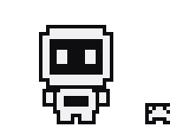
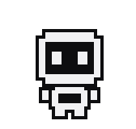
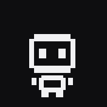
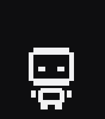
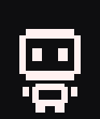
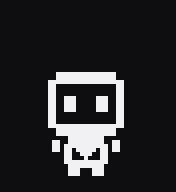

# OPTBOT engineering standards

How every OPTBOT repository, account and contribution looks. Short on purpose; follow it exactly. New members start with [ONBOARDING.md](ONBOARDING.md).

## 1. Names

| Thing | Format | Example |
|---|---|---|
| GitHub username | `firstname-lastname-optbot` | `griffin-thompson-optbot` |
| Display name | Real name | Griffin Thompson |
| Profile picture | One of the official OPTBOT robots ([ONBOARDING.md](ONBOARDING.md#2-profile-picture-pick-one-of-the-official-optbot-robots)) | `optbot-avatar-wave` |
| Commit email | Your @optbotai.com address, verified | griffin@optbotai.com |
| Repository | lowercase, hyphens, a noun | `design-system`, `superhead` |
| Branch | `<type>/<short-topic>` with type `feat`, `fix`, `docs`, `chore`, `research` | `feat/kitchen-supply-pack` |
| Commit message | Conventional Commits: `<type>(<scope>): <what changed>` | `fix(loop): keep the holdout out of tuning` |
| Release tag | `vMAJOR.MINOR.PATCH` | `v1.1.0` |
| Files and folders | lowercase, hyphens; Python modules use underscores | `brand-guidelines.md`, `quote_heads.py` |
| Issue and PR titles | Sentence case, no trailing period | Add kitchen-supply starter pack |

The company name is always **OPTBOT**, in capitals. The product is **OPTBOT Core**.

## 2. Every repository has

`README.md` (what it is, how to run it, layout), `LICENSE` (proprietary), `CLAUDE.md` (how Claude should work in it), `CONTRIBUTING.md`, `.github/CODEOWNERS`, a CI workflow, and the PR and issue templates. A topic list on GitHub that includes `optbot`.

## 3. How work flows

1. One issue per piece of work. Branch from `main` (or `develop` where it exists).
2. Small pull requests, one change each. Fill in the template.
3. CI green and one code-owner approval before merge. **Squash-merge**, then delete the branch.
4. `main` is always releasable. Nobody pushes to it directly.

## 4. Security

- 2FA required for every member, with an authenticator app or passkey (not SMS).
- No secrets, tokens, customer data or other companies' code in any repository. Data lives outside the repo; configs point at it.
- Outside collaborators get access to only the repositories they work on.

## 5. Culture: OPTBOT reactions, not emoji

We react with our own robot. In comments, reviews and Slack, use the OPTBOT reaction GIFs instead of stock emoji:

| | Name | Means | Paste |
|---|---|---|---|
|  | `bug` | Something broke | `` |
|  | `chart` | The numbers are up | `` |
|  | `coffee` | Taking a break | `` |
|  | `eyes` | Looking into it | `` |
|  | `facepalm` | Oops | `` |
|  | `hockey` | CIN, hockey | `` |
|  | `idea` | Good idea | `` |
|  | `laugh` | That's funny | `` |
|  | `love` | Love it | `` |
|  | `on-it` | Working on it | `` |
|  | `party` | Celebrate a win | `` |
|  | `ship-it` | Done, merged, shipped | `` |
|  | `shrug` | Not sure, need data | `` |
|  | `thinking` | Thinking about it | `` |
|  | `thumbs-up` | Approve, looks good | `` |
|  | `trophy` | A result or milestone | `` |
|  | `waiting` | Blocked, waiting | `` |
|  | `wave` | Hello | `` |

Tip: save the ones you use most as **saved replies** (GitHub → Settings → Saved replies), so they're two keystrokes away. Brand rules for everything else: the `design-system` repository.
