# OPTBOT reactions

Drop these into GitHub comments, Slack or chat instead of stock emoji. Each is the outline robot, white on night, doing one clear thing.

| Reaction | Means | Markdown |
|---|---|---|
| 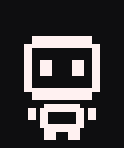 `thumbs-up` | approve, looks good | `` |
|  `ship-it` | done, merged, shipped | `` |
| 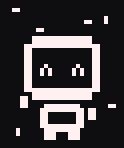 `party` | celebrate a win | `` |
| 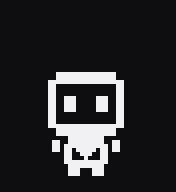 `trophy` | a result, a milestone | `` |
| 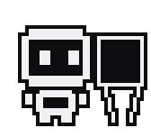 `chart` | the numbers are up | `` |
|  `love` | love it | `` |
| 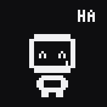 `laugh` | that's funny | `` |
| 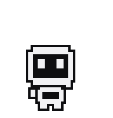 `thinking` | thinking about it | `` |
| 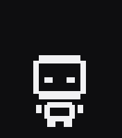 `idea` | good idea | `` |
| 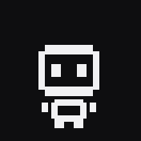 `shrug` | not sure, need data | `` |
|  `facepalm` | oops | `` |
| 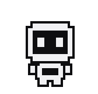 `eyes` | looking into it | `` |
| 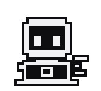 `on-it` | working on it | `` |
| 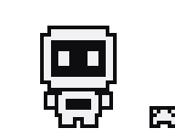 `bug` | something broke | `` |
| 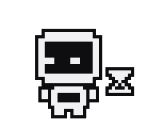 `waiting` | blocked, waiting | `` |
| 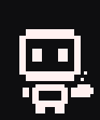 `coffee` | break | `` |
|  `wave` | hello | `` |
| 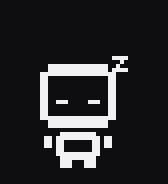 `sleep` | away, offline, brb | `` |
| 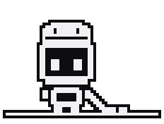 `hockey` | CIN, hockey | `` |
| 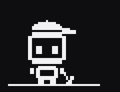 `golf` | nice shot, great work | `` |
| 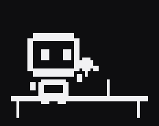 `ping-pong` | back and forth, your turn | `` |
| 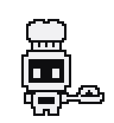 `chef` | cooking something up | `` |
| 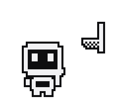 `basketball` | nailed it | `` |
| 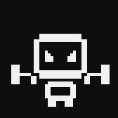 `gym` | putting in the work | `` |
