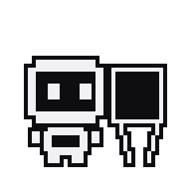
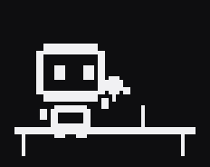
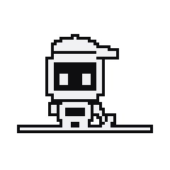

<b>OPTBOT reads messy company data and gives a straight answer, with an honest range.</b> 
<a href="https://www.optbotai.com">optbotai.com</a>

<!-- optbot:gifs -->

<!-- /optbot:gifs -->

| Repository | What it is |
|---|---|
| **superhead** | One model, many heads, trained from labeled business data: the OPTBOT Core engine |
| **cin** | The Causal Intervention Network for hockey player portability |
| **website** | optbotai.com |
| **design-system** | The OPTBOT brand: tokens, logo, robot motion, reactions and the Claude skill |

New here? Start with [onboarding](https://github.com/OptBot-AI/.github/blob/main/ONBOARDING.md), then the [engineering standards](https://github.com/OptBot-AI/.github/blob/main/STANDARDS.md).
