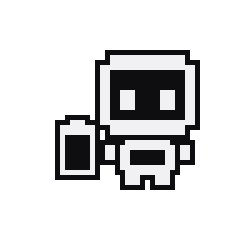
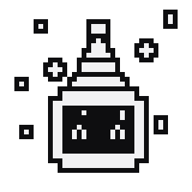

<b>OPTBOT reads messy company data and gives a straight answer, with an honest range.</b>

<!-- optbot:gifs -->

<!-- /optbot:gifs -->

###  Repositories

| | Repository | What it is |
|---|---|---|
|  | **superhead** | One model, many heads, trained from labeled business data: the OPTBOT Core engine |
|  | **cin** | The Causal Intervention Network for hockey player portability |
|  | **website** | optbotai.com |
|  | **design-system** | The OPTBOT brand: tokens, logo, robots, reactions and the Claude skill |

###  New here?

Start with [onboarding](https://github.com/OptBot-AI/.github/blob/main/ONBOARDING.md) (or tell Claude *"onboard me to OPTBOT"*), then the [engineering standards](https://github.com/OptBot-AI/.github/blob/main/STANDARDS.md).

 

 <b>OPTBOT</b> · <a href="https://www.optbotai.com">optbotai.com</a>

