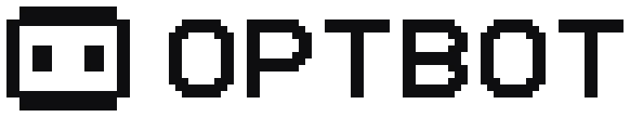
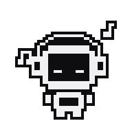
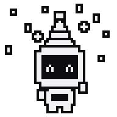
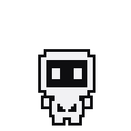
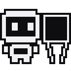
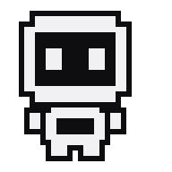

<picture><source media="(prefers-color-scheme: dark)" srcset="https://raw.githubusercontent.com/OptBot-AI/.github/main/assets/brand/optbot-lockup-chalk.png"></picture>

<b>GPT predicts the next word. CPT predicts what happens next.</b>

OPTBOT is an AI research lab. We build <b>CPT-1</b>, a causal pre-trained model that learns what actually drives a business's results from its own records, and ships it as products.

<!-- optbot:gifs -->

<!-- /optbot:gifs -->

###  What we build

| | What it does |
|---|---|
| **CPT-1** | Our causal pre-trained model. Finds the real causes in a company's records and measures what a change will do, with an honest range. |
| **OPTBOT Quote** | Prices any job from past jobs, and knows what actually wins the deal. |
| **OPTBOT Logistics** | Plans docks, routes and carriers around what really causes delays. |
| **OPTBOT Documents** | Drafts contracts and plans with the clauses past deals proved you need. |
| **Custom builds** | CPT-1 built around any decision with a history. First one: OPTBOT Scout for hockey. |

###  Repositories

| Repository | Area | What it is |
|---|---|---|
| **[superhead](https://github.com/OptBot-AI/superhead)** | Research | One model, many small heads: reads a company's paper trail line by line. Research behind CPT-1. |
| **[cin](https://github.com/OptBot-AI/cin)** | Research | The Causal Intervention Network: measures what a change will do. Research behind CPT-1, proven first on hockey. |
| **[website](https://github.com/OptBot-AI/website)** | Product | optbotai.com: the model, the products and the pilots. |
| **[design-system](https://github.com/OptBot-AI/design-system)** | Brand | Tokens, the pixel logo, the robot and its animations, and the Claude skill. |
| **[.github](https://github.com/OptBot-AI/.github)** | Company | Org defaults: onboarding, standards, shared workflows and the OPTBOT bot. |

###  Pilots

- **PurTera IT:** OPTBOT Quote, Logistics and Documents across a full IT services operation.
- **OPTBOT Scout:** a hockey pilot built for NHL front offices, backtested on 860 real player moves.

###  New here?

Start with [onboarding](https://github.com/OptBot-AI/.github/blob/main/ONBOARDING.md) (or tell Claude *"onboard me to OPTBOT"*), then the [engineering standards](https://github.com/OptBot-AI/.github/blob/main/STANDARDS.md).

 

 <b>OPTBOT</b> · AI research lab · <a href="https://www.optbotai.com">optbotai.com</a>

